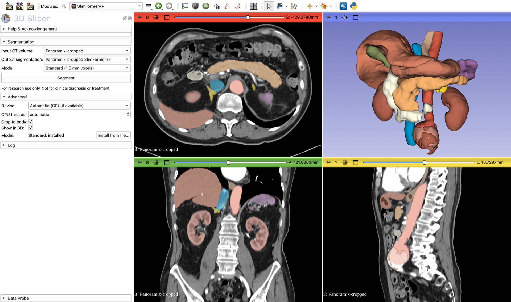

# SlimFormerPlusPlus

A [3D Slicer](https://www.slicer.org) extension that segments 15 abdominal
organs in CT images with SlimFormer++.

**For research use only. This is not a medical device. Do not use the results
for diagnosis or treatment.**

## What it does

- **Input:** a CT volume of the abdomen, loaded in 3D Slicer from DICOM, NIfTI,
  NRRD or any other supported format.
- **Output:** a segmentation with up to 15 structures: spleen, right kidney,
  left kidney, gallbladder, esophagus, liver, stomach, aorta, inferior vena
  cava, pancreas, right adrenal gland, left adrenal gland, duodenum, bladder,
  prostate/uterus.
- **Two modes:** *Standard* (default) works on 1.5 mm voxels and is the most
  accurate; *Fast* works on 3 mm voxels, is several times faster and is less
  accurate, mostly on small organs.
- Runs on an NVIDIA GPU or on the CPU, on Windows, macOS and Linux. Nothing
  has to be compiled.

## Installation

Requires 3D Slicer 5.10 or later.

1. Open the Extensions Manager, search for **SlimFormerPlusPlus**, install it and
   restart Slicer. The PyTorch and NNUNet extensions are installed with it.
2. The first time you click **Segment**, the module asks to install PyTorch
   and nnU-Net into Slicer's Python environment (needs internet; this can take
   several minutes) and then downloads the network weights of the selected
   mode (about 22 MB per mode).

<!-- TODO: remove this section after the extension is in the Extensions Index -->
Until the extension is listed in the Extensions Manager:

1. Install the **PyTorch** and **NNUNet** extensions from the Extensions Manager
   and restart Slicer.
2. Download this repository (Code → Download ZIP) and unpack it.
3. In Slicer, open Edit → Application Settings → Modules, add the unpacked
   `SlimFormerPlusPlus` folder (the one that contains `SlimFormerPlusPlus.py`) to
   *Additional module paths*, and restart Slicer.

## Tutorial

1. Open the **Sample Data** module and load **CTA abdomen (Panoramix)**, or load
   your own abdominal CT.
2. Open the **SlimFormer++** module (category *Segmentation*).
3. Select the CT as *Input CT volume*. Leave *Output segmentation* at
   *Create new segmentation*. Choose the *Mode*: **Standard** or **Fast**.
4. Click **Segment**. The current step, the elapsed time and a progress bar are
   shown below the button, which turns into **Cancel** while segmenting. Details
   are in the (collapsed) *Log* section.
5. The organs appear in the slice views and, with *Show in 3D* enabled, as
   surfaces in the 3D view. Use the **Segment Editor** to correct them or the
   **Segment Statistics** module to measure volumes.

### How long does it take?

The image is resampled to 1.5 mm (*Standard*) or 3 mm (*Fast*) voxels and
processed in overlapping 128³ voxel patches inside the bounding box of the body
(*Crop to body*), so the time grows with the scanned body volume. *Fast* is
several times faster than *Standard*. On macOS, 3D Slicer currently runs
through Rosetta 2 and uses the CPU. 16 GB of RAM or more is recommended.

## Settings (Advanced section)

- **Device:** automatic (an NVIDIA GPU if PyTorch finds one, otherwise the CPU)
  or CPU.
- **CPU threads:** number of threads on the CPU (automatic by default).
- **Crop to body** (on by default): segment only the bounding box of the
  patient's body (voxels above −500 HU, largest connected region, plus a margin
  of about 1 cm), not the air and table around it. Everything outside the box is
  background. Turn it off for images that are not in Hounsfield units or when
  structures outside the body outline are expected.
- **Show in 3D:** create 3D surfaces of the segments.
- **Model / Install from file:** shows whether the network weights of the
  selected mode are installed; *Install from file...* installs them from a
  downloaded model `.zip` file, for computers without internet access. The file
  is recognized as the Standard or Fast model by its checksum.

## Model

- **Network:** SlimFormer++ with window self-attention in encoder 1 (the
  Mamba-free implementation in the
  [SlimFormer++ repository](https://github.com/WHHHHHY822/SlimFormerPlusPlus)),
  6.0 M parameters. It needs only PyTorch, no custom CUDA kernels.
- **Modes:** both modes use this network on isotropic voxels with 128³ voxel
  patches, a 3 × 3 × 3 first-level kernel and a first downsampling stride of
  2 × 2 × 2. *Standard*: 1.5 mm voxels, so the attention stage works on 3 mm
  voxels. *Fast*: 3 mm voxels (attention on 6 mm voxels); a patch covers 8 times
  the volume for the same computation.
- **Training:** nnU-Net v2 `3d_fullres` on AMOS2022 CT (200 training scans),
  100 epochs each, initialized from an AMOS2022 CT model trained on
  2.0 × 0.68 × 0.68 mm voxels (itself fine-tuned for 100 epochs from the released
  SlimFormer++ AMOS2022 CT weights). The checkpoint with the best validation
  score during training is used.
- **Sliding window:** neighbouring patches overlap by 20 % (nnU-Net's default
  is 50 %).
- **Pre- and post-processing:** nnU-Net v2. Before inference the image axes are
  permuted/flipped (never interpolated) to the orientation of the training
  data, and the result is mapped back to the original voxel grid. The
  conversion of the network output back to the original grid gives the same
  labels as nnU-Net but needs less memory and time: only the voxels next to a
  label boundary are interpolated.

## License

The Slicer module and its helper code are under the
[Apache License 2.0](LICENSE.txt). The network definition
(`SlimFormerPlusPlus/SlimFormerPlusPlusLib/model.py`) and the network weights are under the
[SlimFormer++ Noncommercial Research License 1.0](LICENSE-MODEL.txt):
noncommercial research use only. See [NOTICE.md](NOTICE.md) for third-party code.

## Citation

If you use this extension, please cite:

- SlimFormer++: <https://github.com/WHHHHHY822/SlimFormerPlusPlus>
- nnU-Net: Isensee F, Jaeger PF, Kohl SAA, Petersen J, Maier-Hein KH. nnU-Net:
  a self-configuring method for deep learning-based biomedical image
  segmentation. *Nature Methods* 18, 203–211 (2021).
- AMOS: Ji Y, et al. AMOS: A large-scale abdominal multi-organ benchmark for
  versatile medical image segmentation. *NeurIPS 2022 Datasets and Benchmarks*.
