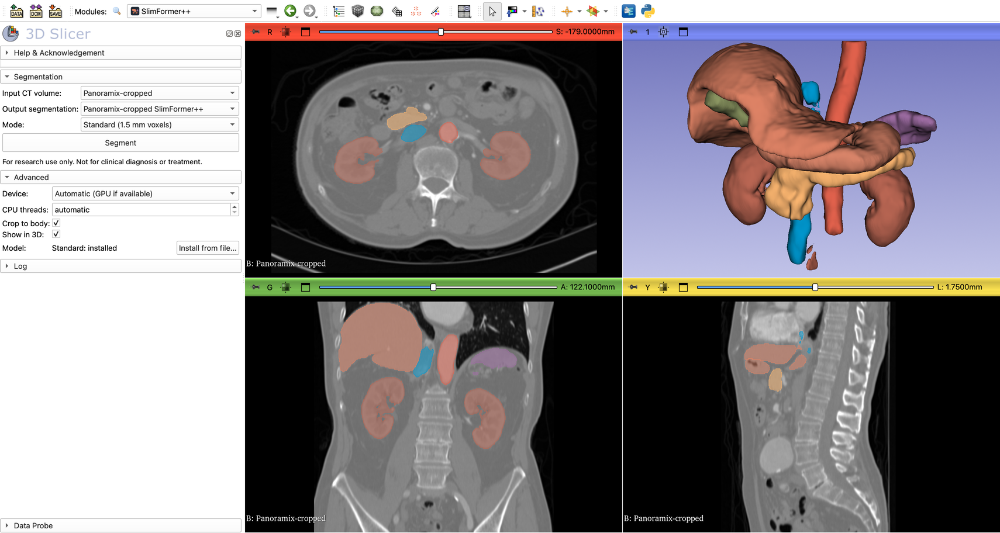

# SlimFormerPlusPlus

A [3D Slicer](https://www.slicer.org) extension that segments 9 abdominal
organs in CT with SlimFormer++: liver, spleen, left and right kidney,
gallbladder, stomach, pancreas, aorta and inferior vena cava. It runs on an
ordinary CPU, with no GPU needed (an NVIDIA GPU is used if present), on
Windows, macOS and Linux.

**For research use only. Not a medical device; do not use the results for
diagnosis or treatment.**

## Accurate with few parameters

All networks trained on AbdomenAtlas 1.0 and tested on the same 743 CT scans
(the TotalSegmentator v2.0.1 scans of the Touchstone Benchmark, not used for
training). Mean Dice and NSD (1.5 mm tolerance) over the 9 organs.

| Network | Parameters (M) | GFLOPs | Dice (%) | NSD (%) |
| --- | ---: | ---: | ---: | ---: |
| **SlimFormer++** (Standard mode) | **6.00** | **482.4** | **85.09** | **83.05** |
| STU-Net-L¹ | 440.11 | 28741.2 | 82.97 | 78.91 |
| STU-Net-H¹ | 1457.04 | 95111.7 | 82.68 | 78.55 |
| nnU-Net ResEnc L | 102.27 | 5271.8 | 82.66 | 78.60 |
| STU-Net-B | 58.17 | 3806.9 | 82.52 | 78.21 |
| MedNeXt | 61.78 | 2512.3 | 80.87 | 76.90 |

GFLOPs for one 128 × 128 × 128 input. Other networks: computed from the
per-case results published by the
[Touchstone Benchmark](https://github.com/MrGiovanni/Touchstone). SlimFormer++:
our evaluation of the same scans and organs, with test-time augmentation.

¹ Touchstone publishes results for 656 of the 743 scans; on those 656,
SlimFormer++ scores 85.40 / 83.34.

## Two modes, CPU only

| Mode | Voxels | Time for the sample CT | Dice / NSD (%) in the module |
| --- | --- | --- | --- |
| **Standard** | 1.5 mm | ~1 min | 84.2 / 81.7 |
| **Fast** | 3 mm | ~15 s | 78.2 / 75.6 |

Time: the Panoramix sample CT in 3D Slicer, on a laptop with an Apple M5 CPU
(10 threads); scans that cover more of the body take longer. Dice / NSD: the
same 743 scans with the module's own settings (no test-time augmentation).
Fast mode is less accurate mostly on scans that show only part of the abdomen.

## Installation

Requires 3D Slicer 5.10 or later.

1. Download this repository (green **Code** button → **Download ZIP**) and
   unzip it to a folder you will keep; Slicer loads the module from there.
2. In Slicer, open **View → Extensions Manager** and install the **PyTorch**
   and **NNUNet** extensions.
3. Open **Edit → Application Settings → Modules** and add the unzipped
   `SlimFormerPlusPlus` folder (the one that contains `SlimFormerPlusPlus.py`)
   to *Additional module paths*: click **Add**, or drag the folder onto the
   list. Click **OK**.
4. Restart Slicer.

The first **Segment** asks to install PyTorch and nnU-Net into Slicer; click
**OK**. This happens once. If Slicer then asks to restart, restart it and click
**Segment** again. The network weights (about 22 MB per mode) are downloaded
on first use.

<!-- TODO: after the extension is in the Extensions Index, replace steps 1-4 with
"In the Extensions Manager, install SlimFormerPlusPlus and restart Slicer." -->

## Usage

The extension has one module, **SlimFormer++** (category *Segmentation*): it
segments 9 abdominal organs in a CT volume into a segmentation.

1. Load an abdominal CT, or the sample **CTA abdomen (Panoramix)** from the
   Sample Data module.
2. Open the **SlimFormer++** module, select the CT and a mode: **Standard**
   (most accurate) or **Fast** (quickest).
3. Click **Segment**. Correct the result in the Segment Editor if needed.

- No internet? Download the model `.zip` from
  [Releases](https://github.com/WHHHHHY822/SlicerSlimFormerPlusPlus/releases) and
  use *Advanced → Install from file*.
- Images not in Hounsfield units: turn off *Advanced → Crop to body*.

## Model

- SlimFormer++ with window self-attention in encoder 1 (the Mamba-free
  implementation in the
  [SlimFormer++ repository](https://github.com/WHHHHHY822/SlimFormerPlusPlus)),
  6.0 M parameters, plain PyTorch.
- Trained with nnU-Net v2 on the 5,195 CT scans of the public
  [AbdomenAtlas 1.0](https://github.com/MrGiovanni/AbdomenAtlas) release, on
  1.5 mm (Standard) or 3 mm (Fast) voxels.

## License

The Slicer module is under the [Apache License 2.0](LICENSE.txt). The network
definition (`SlimFormerPlusPlus/SlimFormerPlusPlusLib/model.py`) is under the
[SlimFormer++ Noncommercial Research License 1.0](LICENSE-MODEL.txt). The
network weights are under [CC BY-NC-SA 4.0](LICENSE-WEIGHTS.txt), the license of
the AbdomenAtlas 1.0 training data. Noncommercial use only. Third-party code:
[NOTICE.md](NOTICE.md).

## How to cite

If you use this extension, please cite:

- SlimFormer++: <https://github.com/WHHHHHY822/SlimFormerPlusPlus>
- nnU-Net: Isensee F, Jaeger PF, Kohl SAA, Petersen J, Maier-Hein KH. nnU-Net:
  a self-configuring method for deep learning-based biomedical image
  segmentation. *Nature Methods* 18, 203–211 (2021).
- AbdomenAtlas: Li W, et al. AbdomenAtlas: A large-scale, detailed-annotated,
  & multi-center dataset for efficient transfer learning and open algorithmic
  benchmarking. *Medical Image Analysis* 97, 103285 (2024); and Qu C, et al.
  AbdomenAtlas-8K: Annotating 8,000 CT volumes for multi-organ segmentation in
  three weeks. *NeurIPS 2023*.
- Touchstone (comparison above): Bassi PRAS, et al. Touchstone Benchmark: Are
  we on the right way for evaluating AI algorithms for medical segmentation?
  *NeurIPS 2024 Datasets and Benchmarks*.
